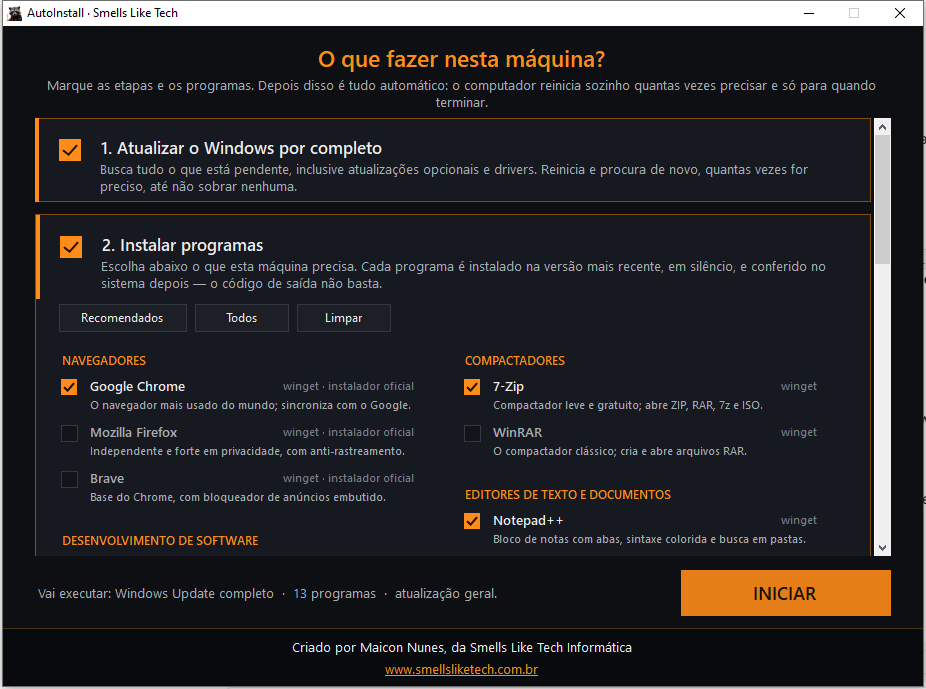
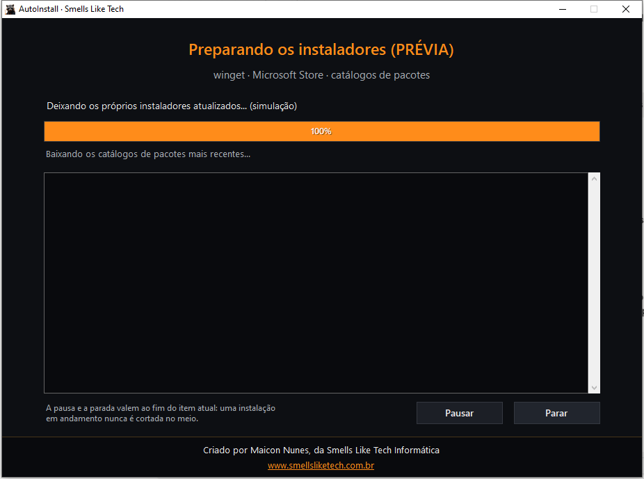
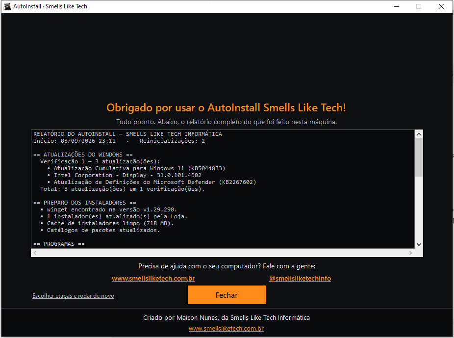
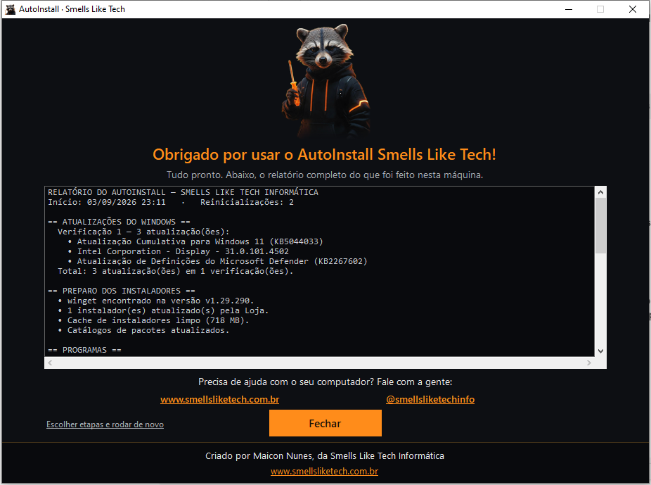

# AutoInstall — Smells Like Tech

Aplicação para automatizar o pós-formatação de computadores com Windows 10/11.

O técnico escolhe o que deseja executar em uma única tela e o programa cuida de atualizações, instalações, reinicializações e retomada do processo.



## O que automatiza

### Windows Update

- atualizações obrigatórias e opcionais;
- drivers;
- Microsoft Update;
- instalação de atualizações exclusivas separadamente;
- reinicialização automática quando necessária;
- retomada do ponto salvo após o logon;
- novas rodadas até não restarem atualizações ou atingir o limite de segurança.

A busca é assíncrona, cancelável e tem limite de 10 minutos por tentativa.
Downloads são cancelados após 15 minutos sem avanço dos bytes recebidos.
Busca e download têm até três tentativas em caso de exceção ou timeout, sempre
aguardando a confirmação do cancelamento antes de repetir. A conclusão e o
progresso são consultados diretamente no agente, sem depender da entrega dos
callbacks COM. A cada 30 segundos a tela mostra a etapa em andamento e o tempo
decorrido. Essa espera normal não é registrada como erro nem repetida no log.

Instalações em andamento são aguardadas sem encerramento forçado. Se o agente
não confirmar o cancelamento em 60 segundos ou a comunicação com uma operação
ativa for perdida, as etapas seguintes ficam suspensas e o estado é preservado.
Falhas entram no relatório; um erro de consulta não significa que o Windows está
atualizado. Reinícios ocorrem somente quando solicitados pelo agente, com limite
de oito rodadas/reinicializações.

### Preparo dos instaladores

Executado antes de qualquer instalação, porque instalador desatualizado é a
maior causa de falha:

- atualização do winget pela API da Microsoft Store;
- atualização do cliente da Loja, de que depende a fonte `msstore`;
- `winget source update` para renovar o catálogo local de manifestos;
- localização do winget por caminho absoluto, sem substituir o PATH do processo;
- limpeza do cache de instaladores em `%TEMP%\WinGet`.

O catálogo de manifestos é o ponto crítico: quando o fabricante republica o
instalador, o hash em cache fica defasado e a instalação falha com
`0x8A150011`. Renovar o catálogo antes resolve a causa; o *fallback* por
`--ignore-security-hash` continua como segunda linha de defesa.



### Instalação de programas

Catálogo por categorias com múltiplas estratégias de instalação:

- winget;
- Microsoft Store;
- instalador oficial;
- script oficial do fabricante;
- Office Deployment Tool.

A instalação é validada pelo estado real do sistema, e não apenas pelo código de saída do instalador.

São **95 aplicativos em 20 categorias**, com busca por nome, descrição ou
finalidade (sem distinção de acentos) e filtro por categoria:

- uso geral: navegadores, compactadores, documentos, PDF e digitalização,
  comunicação, produtividade, nuvem e utilitários;
- estudantes e pesquisadores: Anki, calibre, Zotero e GeoGebra;
- criação: imagem, vídeo, música, produção de áudio, 3D, CAD e eletrônica;
- desenvolvedores e técnicos: desenvolvimento, acesso remoto, redes,
  diagnóstico e manutenção;
- outros públicos: jogos, segurança, inteligência artificial e acessibilidade
  (NVDA e Balabolka).

**Todos visíveis** e **Limpar visíveis** afetam apenas o resultado do filtro;
escolhas em outras categorias permanecem marcadas. Limpe a busca e selecione
**Todas as categorias** para aplicar esses botões ao catálogo inteiro.
**Recomendados** restaura a seleção padrão do catálogo. Os novos aplicativos
ficam desmarcados por padrão. Contas, licenças e configurações específicas de
cada aplicativo continuam sendo necessárias quando aplicável.

### Atualização do software instalado

- `winget upgrade --all`;
- atualizações dos aplicativos da Microsoft Store;
- múltiplas passadas quando necessário.

### Como a máquina fica no fim

Opção **"Sou ousado"**, marcada por padrão:

| | Marcado | Desmarcado |
| --- | --- | --- |
| Plano de energia | Desempenho máximo permanente: nada desliga, suspende ou hiberna | Equilibrado (padrão do Windows) |
| Protetor de tela | Faixas em 15 minutos | não altera |

O protetor existe por causa do plano: com a tela ligada para sempre, imagem
parada por horas marca o monitor. Ele resolve isso sem devolver a máquina ao
modo que desliga e suspende tudo.

A configuração do protetor é gravada no perfil de quem executou **e** nos
perfis reais carregados em `HKEY_USERS`. O programa roda elevado; quando a
elevação vem de uma conta de administrador diferente da que usa o computador,
só o `HKEY_CURRENT_USER` não bastaria.

## Stack

C# · .NET Framework · WinForms · Windows Update COM API · winget · Microsoft Store API · PowerShell

## Fluxo de execução

```text
Escolha
   │
   ├── Windows Update
   ├── Instalar programas
   ├── Atualizar programas existentes
   └── Sou ousado (como a máquina fica no fim)
             │
             ▼
    preparo dos instaladores
   (quando há algo a instalar)
             │
             ▼
       execução automática
             │
       reinicia se necessário
             │
       retoma do estado salvo
             │
             ▼
    energia e protetor de tela
             │
             ▼
          relatório
```

| Execução | Relatório |
| --- | --- |
|  |  |

## Algumas decisões técnicas

### Atualização sem interromper operações críticas

Pausar ou parar é respeitado entre itens. Um instalador em execução não é encerrado abruptamente.
Na busca e no download do Windows Update, **Parar** solicita cancelamento ao
agente; a pausa aguarda o fim da operação atual. Entre lotes e atualizações
exclusivas, ambos os comandos são respeitados antes de iniciar a próxima parte.

### Persistência entre reinicializações

O estado da execução é salvo antes do reboot. Uma tarefa agendada reabre a aplicação e o processo continua do ponto correto.

### Office pelo ODT

O Microsoft 365 é instalado pelo Office Deployment Tool com configuração explícita e a presença real do Click-to-Run é verificada ao final.

### Estratégias de fallback

Quando uma via de instalação falha, o catálogo pode tentar outra fonte oficial definida para aquele programa.

## Como compilar

```bat
build.bat
```

O projeto utiliza o compilador do .NET Framework presente no Windows e gera um executável para uso em bancada.

### Verificações

```powershell
.\tools\testar.ps1
.\tools\testar.ps1 -WindowsUpdateLocal
.\tools\verificar-catalogo.ps1
```

O primeiro comando testa as esperas, cancelamentos, catálogo, filtros, seleção
e compatibilidade do estado salvo; também renderiza a tela em PNG dentro de
`bin`. O segundo acrescenta uma busca COM somente de leitura no cache local,
sem downloads, instalações, registro de serviços ou mudanças de energia.
O terceiro consulta os IDs no repositório oficial `microsoft/winget-pkgs`
e requer GitHub CLI autenticado e acesso à rede. Existência do manifesto não
substitui o teste do instalador em cada versão/arquitetura do Windows.

Consulte [o diagnóstico e a validação do Windows Update](docs/windows-update.md).

## Uso

```text
AutoInstall.exe
AutoInstall.exe --resume
AutoInstall.exe --preview
```

`--resume` é usado pela retomada automática após reinicialização.

`--preview` demonstra as telas com dados fictícios. Não lê nem grava o estado
salvo, o log ou qualquer configuração da máquina.

## Autor

**Maicon Nunes** — Smells Like Tech Informática  
[GitHub](https://github.com/mikerock12) · [Site](https://www.smellsliketech.com.br)


## Portal e publicações

Demonstração, recursos e download da última versão: [Softwares SLT](https://softwares.smellsliketech.com.br/apps/autoinstall/).

Cada merge em `main` passa pelo CI e gera uma nova release estável com SHA-256. O portal consulta a release mais recente automaticamente (cache de até cinco minutos). Código-fonte é mantido neste repositório; o projeto central apenas o referencia como submódulo.

Recomendados: Google Chrome, 7-Zip, Microsoft 365, Adobe Reader, WhatsApp, Telegram, VLC Media Player e K-Lite Codec Pack **Mega**. Microsoft 365 requer licença.
